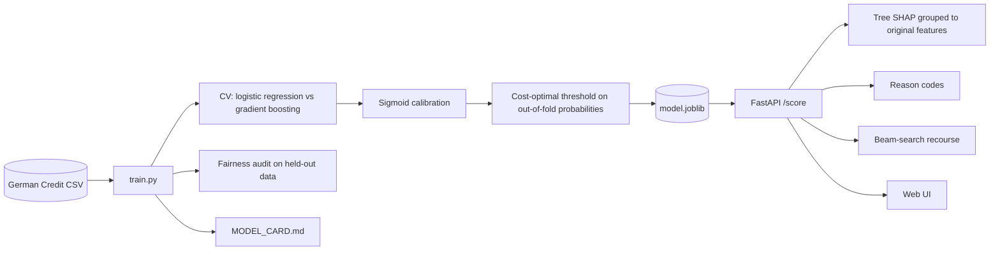

# Explainable Credit-Risk Scorer

Credit scoring that can justify itself. The service returns a **calibrated probability of default** and a **cost-optimised decision**. With every decision it also gives:
- the **SHAP reasons** behind the score,
- adverse-action **reason codes**,
- **actionable recourse**, meaning the cheapest realistic changes that would turn a decline into an approval.

The model ships with a **fairness audit** and an auto-generated **model card**.

Built on the public German Credit (Statlog) dataset. It's a portfolio and educational project, **not a real lending system**.

## Problem

Lending models must answer three questions that accuracy alone doesn't:

1. **Why was I declined?** Regulators (e.g. ECOA/Reg B, GDPR Art. 22) expect specific reasons.
2. **What can I do about it?** A good reason is useless without a path to approval.
3. **Is it fair?** Outcomes must be checked across protected groups even when those attributes aren't used.

## Solution



| Component | What it does |
|---|---|
| **Fair-by-design inputs** | `personal_status` (encodes sex), `age` and `foreign_worker` are excluded from the model and used only to audit outcomes |
| **Model selection** | 5-fold CV ROC-AUC compares logistic regression and gradient boosting; the winner is wrapped in `CalibratedClassifierCV` |
| **Cost-sensitive decisions** | Uses the Statlog cost matrix: approving a defaulter costs 5× rejecting a good customer. The threshold minimises expected cost on honest out-of-fold predictions, not test data |
| **Explanations** | Exact Tree SHAP, with one-hot columns summed back to the 17 original features. Additivity is enforced in tests: base + Σ contributions = model score |
| **Reason codes** | The top four factors that pushed this applicant's risk up |
| **Recourse** | Beam search over up to three *actionable* changes (higher checking/savings balance, a smaller or shorter loan, a lower instalment ratio, closing other credit, adding a guarantor). Changes go in plausible directions only, have effort costs, and only minimal options are kept. Immutable traits (credit history, employment, age, …) are never suggested |
| **Fairness audit** | Per group: approval rate (demographic parity), approval rate among creditworthy applicants (equal opportunity), disparate-impact ratio against the four-fifths rule. Groups too small to compare are flagged, not hidden |

## Results (held-out test set, 250 applicants)

| Metric | Value |
|---|---|
| ROC-AUC | **0.814** (CV on train: gradient boosting 0.771, logistic regression 0.764) |
| Brier score | 0.153 (base-rate predictor: 0.21) |
| Expected cost per applicant | **0.556**, versus 0.70 for rejecting everyone and 1.50 for approving everyone |
| Approval rate | 40.8%, strict by design because of the 5:1 cost ratio |
| Default rate among approved | 10.8% (population base rate 30%) |
| Recourse coverage | 113 of 148 declined test applicants (76%) get at least one option within 3 changes |

Fairness (four-fifths rule): **sex** disparate impact 0.83 (passes), **age <25 vs ≥25** 0.84 (passes). **Foreign worker** can't be assessed because the test set has only 8 local workers. See [`MODEL_CARD.md`](MODEL_CARD.md) for every group's numbers and the global SHAP importances. Checking-account status, loan duration and credit amount dominate.

## Getting started

```bash
python -m venv .venv && source .venv/bin/activate      # Windows: .venv\Scripts\activate
pip install -e ".[dev]"
python -m credit_risk.train          # trains, saves artifacts/model.joblib, writes MODEL_CARD.md
uvicorn credit_risk.api:app          # http://localhost:8000  (trains automatically if no artifact exists)
```

Docker (the model is trained during the image build):

```bash
docker build -t credit-risk .
docker run -p 8000:8000 credit-risk
```

## API

| Method | Path | Description |
|---|---|---|
| GET | `/health` | Status, model name, training time |
| GET | `/schema` | Features, allowed values and bounds, and an example applicant |
| POST | `/score?recourse=true` | Applicant JSON (17 features) → decision, probability, SHAP contributions, reason codes, recourse |
| GET | `/model` | Metrics, threshold, CV scores, global importance, fairness audit |

Unknown categories, out-of-range numbers, missing fields, and any attempt to send a protected attribute all return `422` with a message per field.

Example `/score` response, abridged:

```json
{
  "decision": "refer/decline",
  "probability_of_default": 0.437,
  "threshold": 0.19,
  "reason_codes": ["Checking account balance (DM): 0<=X<200", "Loan duration (months): 24", "Savings balance (DM): <100"],
  "explanation": {"units": "log-odds of default (positive = riskier)", "base_value": -0.95, "model_score": 0.41,
                  "contributions": [{"feature": "checking_status", "value": "0<=X<200", "shap": 0.52}, "..."]},
  "recourse": [{"changes": [{"action": "Shorten the loan to 12 months"}, {"action": "Add a guarantor"}],
                "total_effort": 5.5, "new_probability": 0.168}]
}
```

## Tests

```bash
pytest -q
```

16 tests cover:
- applicant validation, including rejection of protected attributes
- the cost and threshold maths, and that the model beats its baselines
- that protected attributes are never model inputs
- SHAP additivity on 20 applicants, and that reason codes cite only risk-raising factors
- recourse: it flips the decision, never touches immutable features, moves only in plausible directions, keeps only minimal options and sorts them by effort
- the fairness metrics on a hand-computed example, plus small-group handling
- the full API

## Limitations

- The data is 1,000 applicants from 1994. Results show the method, not deployable performance.
- Leaving out protected attributes doesn't remove proxies, which is why outcomes are audited.
- SHAP explains the uncalibrated scores. Calibration is a monotone sigmoid, so the reasons and their ranking are unchanged.
- Recourse options are model what-ifs, not promises.

## Future enhancements

- Monotonic constraints (e.g. risk must not fall as the loan amount rises) via `HistGradientBoostingClassifier(monotonic_cst=...)`
- Post-processing fairness mitigation (group-aware thresholds) with a before/after comparison
- Drift monitoring on incoming applications
- Counterfactual diversity (DiCE-style) and per-user effort preferences

## Data and license

Dataset: *Statlog (German Credit Data)*, Hofmann (1994), UCI Machine Learning Repository / OpenML `credit-g`, CC BY 4.0. Code: MIT.
